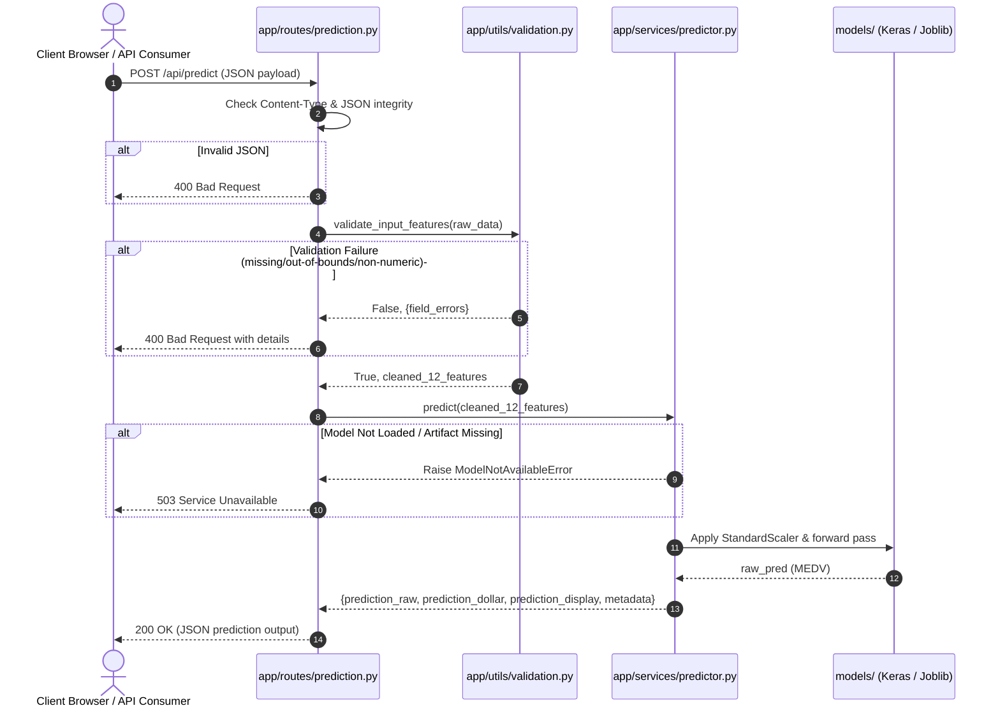

# EstateIQ Architecture Specification

## 1. High-Level Design Principles

EstateIQ is architected around five core principles:

1. **Application Factory Pattern (`app/__init__.py`)**: Enables dynamic environment configuration, clean dependency injection, and isolated testing contexts.
2. **Decoupled Machine Learning Service (`app/services/predictor.py`)**: The model inference layer is completely decoupled from Flask request objects and HTTP semantics. It can be instantiated and executed in standalone scripts, background workers, or unit tests without Flask.
3. **Fail-Fast Validation Boundary (`app/utils/validation.py`)**: All user inputs pass through a strict schema validation layer before reaching the inference service.
4. **Zero Startup Retraining**: Model training is strictly separated into offline scripts (`scripts/train_model.py`). The web server only loads pre-serialized artifacts (`models/`).
5. **Multi-Engine Inference Support**: The predictor supports both TensorFlow/Keras Sequential ANNs (`boston_housing_model.keras`) and Scikit-Learn pipelines (`boston_housing_pipeline.joblib`).

---

## 2. Request & Inference Sequence

---

## 3. Component Responsibilities

| Component | File Path | Responsibilities |
| :--- | :--- | :--- |
| **App Factory** | `app/__init__.py` | Creates the Flask app, registers blueprints, configures logging, registers 404/500 handlers, and attaches the initialized `PredictorService`. |
| **Configuration** | `app/config.py` | Holds `BaseConfig`, `DevelopmentConfig`, `TestingConfig`, and `ProductionConfig` classes with typed environment overrides. |
| **Main Routes** | `app/routes/main.py` | Serves server-side rendered HTML views (`/` and `/about`). Injects model readiness and feature dictionaries. |
| **Prediction Routes** | `app/routes/prediction.py` | Exposes REST endpoints (`/api/predict`, `/api/health`, `/api/sample`), validates headers, and maps exceptions to standard HTTP error codes. |
| **Inference Service** | `app/services/predictor.py` | Manages artifact lifecycle, feature array construction, scaler application, and inference forward passes. |
| **Validation Engine** | `app/utils/validation.py` | Defines empirical bounds, schema types, and sanitizes input data. |
| **Training Pipeline** | `scripts/train_model.py` | Offline script to execute model training, cross-validation, and artifact serialization. |
| **WSGI Entrypoint** | `wsgi.py` | Production server entrypoint that initializes the application via `create_app()` and starts Gunicorn/Flask. |

---

## 4. Error Handling Strategy

| Scenario | HTTP Status | Response Structure / Template |
| :--- | :--- | :--- |
| Missing / Malformed JSON body | `400 Bad Request` | `{"success": false, "error": "Request body must be valid JSON..."}` |
| Missing required features | `400 Bad Request` | `{"success": false, "error": "Validation failed", "details": {...}}` |
| Invalid categorical value (CHAS != 0 or 1) | `400 Bad Request` | `{"success": false, "details": {"CHAS": "CHAS must be exactly 0 or 1"}}` |
| Value outside allowable bounds | `400 Bad Request` | `{"success": false, "details": {"<field>": "Value is below minimum..."}}` |
| Model artifact not loaded on server | `503 Service Unavailable` | `{"success": false, "error": "Prediction service is currently unavailable..."}` |
| Unhandled server exception | `500 Internal Server Error` | `{"success": false, "error": "An unexpected error occurred..."}` |
| Unknown web URL | `404 Not Found` | Rendered `404.html` (or JSON if `/api/*`) |
